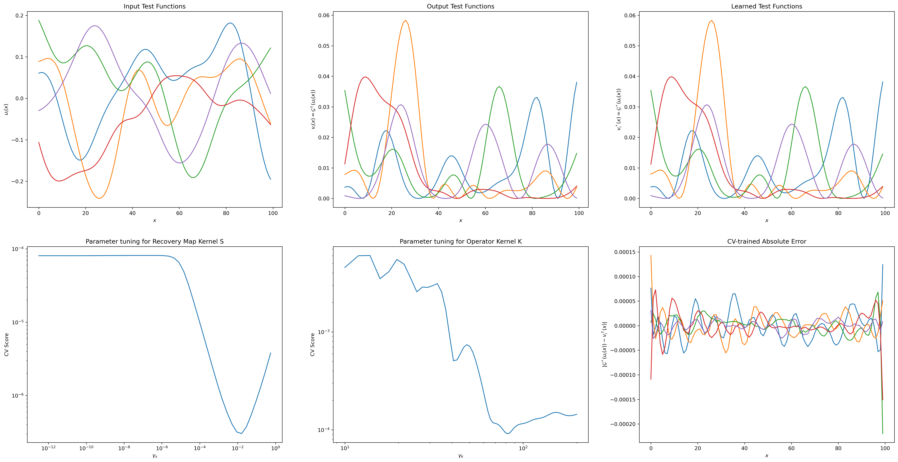
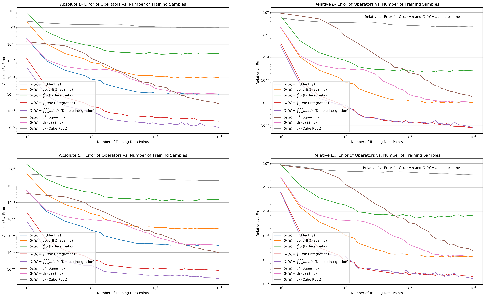

# Kernel Methods for Operator Learning

Final project for AMATH 563 (*Inferring Structure of Complex Systems*), University of Washington, Spring 2024.
**Team:** Levent Batakci, Qi Liang, Fisher Ng, Arjun Sethi-Olowin · **Report:** [`report/AMATH563_Final_Report.pdf`](report/AMATH563_Final_Report.pdf)

Operator learning approximates a map between function spaces, $\mathcal{G}^\dagger : u \mapsto v$, from example input–output pairs. We implement the kernel encoder/decoder method of Batlle, Darcy, Hosseini & Owhadi (2023), test it on eight linear and nonlinear operators, and compare it against DeepONet.


*Squaring operator $u \mapsto u^2$. Top: input test functions, true outputs, learned outputs. Bottom: cross-validation curves for both kernels and the pointwise error. 1,000 training functions.*

## Method

Each function is represented by its values at 100 equispaced collocation points on $[0,1]$. The learned operator is

$$
\mathcal{G}^*(u) = \left(\psi^{-1} \circ f^* \circ \phi\right)(u), \qquad f^*(\cdot) = K(\cdot,\Phi)\,K(\Phi,\Phi)^{-1}\,\Psi ,
$$

where $\phi,\psi$ are pointwise evaluation maps, $f^*$ is kernel interpolation between the encoded inputs and outputs, and $\psi^{-1}$ is a second kernel regression that recovers a function from its point values. Both kernels are RBF, $k(x,x') = \exp(-\gamma\lVert x-x'\rVert_2^2)$, with a small nugget for stability.

- **Implemented from scratch** in NumPy: both applications of the kernel trick and the k-fold cross-validation used to select $\gamma$ (10-fold for the recovery kernel, 5-fold for the operator kernel). See [`KLearn.py`](KLearn.py).
- **Training data:** random smooth functions sampled from a Gaussian process (RBF covariance, Cholesky factorization), normalized to unit norm.
- **Operators:** identity, scaling ($10u$), derivative, single and double integral (linear); $u^2$, $\sin u$, $u^{1/3}$ (nonlinear).
- **DeepONet baseline:** notebook 06 trains a DeepONet with DeepXDE (PyTorch backend; branch and trunk networks with three layers of width 40, 30,000 iterations) to learn the derivative of random polynomials and their compositions with $\sin$.

## Results


*Absolute and relative $L^2$ and $L^\infty$ test errors against the number of training functions.*

- Smoothing operators are easiest. The integral operators reach relative $L^2$ errors near $10^{-5}$, and the identity, squaring, and sine operators reach about $10^{-4}$. The derivative stays between $10^{-3}$ and $10^{-2}$. The cube root is not learned with RBF kernels.
- Linear operators improve sharply from 10 to 100 training functions and plateau beyond about 1,000.
- Compared with DeepONet, the kernel method's relative error is about half an order of magnitude lower on every operator except the cube root (report, §4.4).
- The main limitation is scale: the dense kernel matrices limit the size of the training set.

## Repository layout

```
KLearn.py                 kernel operator learning + cross-validation (NumPy)
notebooks/
  01_random_functions.ipynb      Gaussian-process sampling of training functions
  02_kernel_method_basic.ipynb   first end-to-end version
  03_kernel_method_gp.ipynb      kernel method on GP-generated data
  04_operator_examples.ipynb     per-operator results and CV curves
  05_convergence_study.ipynb     error and optimal γ vs. number of training functions
  06_deeponet_baseline.ipynb     DeepONet baseline (DeepXDE, PyTorch backend)
figures/                  figures used in the report
prototyping/              early MATLAB prototypes
report/                   final report (PDF)
```

## Running

```bash
pip install -r requirements.txt
jupyter lab notebooks/
```

Developed with Python 3.11. `jax` is needed only for notebook 02, and `deepxde` and `torch` only for notebook 06.

## References

1. P. Batlle, M. Darcy, B. Hosseini, and H. Owhadi. *Kernel methods are competitive for operator learning.* 2023.
2. L. Lu, P. Jin, G. Pang, Z. Zhang, and G. E. Karniadakis. *Learning nonlinear operators via DeepONet based on the universal approximation theorem of operators.* Nature Machine Intelligence 3 (2021), 218–229.

## Acknowledgements

We thank Professor Hosseini for discussions on generating random functions with Gaussian processes and for example code, and our TA Juan Osorio Ramirez for feedback on kernel selection, choice of operators, and input normalization.
